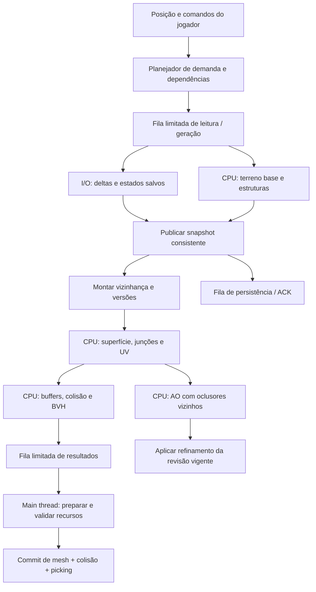

# Plano de implementação — MVP voxel com octaedros truncados

**Data:** 16/10/2026. **Projeto de referência:** `/home/jhonn/Documents/projects/game-godot`.

**Estado deste documento:** planejamento para execução por um agente futuro. Nenhuma funcionalidade descrita como futura foi implementada nesta entrega. Os números de desempenho são metas iniciais, não resultados medidos.

## 1. Resultado a entregar

Um jogo singleplayer de exploração e construção, em primeira pessoa, com mundo procedural carregado sob demanda. O jogador deve poder caminhar, correr, pular, nadar, explorar cavernas, coletar e colocar blocos, usar inventário, encontrar árvores e criaturas e sair/voltar sem perder suas alterações.

Preservar a aparência aprovada: octaedros truncados facetados, pontas nas regiões irregulares e conexões planas locais entre quatro células alinhadas, nas seis direções. Adicionar texturas sem transformar o terreno em cubos, arredondar sua silhueta ou voltar a desenhar quadradinhos nas superfícies conectadas.

### Escopo fechado do MVP

| Incluído | Comportamento mínimo verificável |
|---|---|
| Mundo | Seed persistida, X/Z gerados sob demanda, cavernas, streaming e origem flutuante |
| Blocos | Grama, terra, pedra, areia, neve, madeira, folhas e rocha de fundo |
| Movimento | Primeira pessoa, gravidade, colisão, andar/correr/pular, natação, pausa e respawn |
| Construção | Seleção visível, quebrar e colocar, alcance limitado, atualização da superfície conectada |
| Inventário | Hotbar de 9 posições + mochila de 27; pilhas de até 64; coleta e consumo transacionais |
| Biomas | Planície, deserto e neve; transições determinísticas e árvores coerentes |
| Água | Lagos/nível de água, natação, fontes e propagação local simplificada; persistência |
| Criaturas | Uma espécie passiva, com variantes visuais por bioma; andar, parar e evitar obstáculos |
| Salvamento | Mundo, inventário, posição, estado de fluidos alterado e entidades persistentes |
| Entrega | Executável de desenvolvimento, controles documentados, mundo de teste e testes automatizados |

Não fazem parte deste MVP: multiplayer, crafting, combate, fome, temperatura, ferramentas com durabilidade, redstone, veículos, reprodução de animais, simulação hidráulica física, iluminação voxel propagada, LOD com transições complexas e todas as regras do Minecraft. A inspiração define o ciclo de exploração/construção; não implica reproduzir o jogo inteiro.

Mundo novo começa com pequenas pilhas de terra, pedra e madeira para permitir construção imediata. Mineração entrega diretamente ao inventário; se ele estiver cheio, a ação é recusada antes de remover o bloco. Drops físicos e descarte de itens ficam para uma extensão posterior. Água natural não ocupa slot nem exige balde no MVP.

### O que significa “infinito”

Não há mapa X/Z pré-construído nem necessidade de carregar tudo. Há uma janela residente limitada que acompanha o jogador. O MVP tem altura lógica finita, inicialmente `-128 <= gy <= 127`; as duas camadas inferiores, `gy=-128` e `gy=-127`, são rocha de fundo não removível. Uma única camada não veda necessariamente o fundo da rede BCC, pois há contatos verticais de duas camadas. Acima do teto não se coloca bloco. Esses limites pertencem ao formato/versionamento do mundo.

Consultas abaixo do domínio retornam sólido virtual conhecido e impenetrável; acima dele retornam ar conhecido sem permissão de colocação. Esses casos nunca são `Unknown`. As duas camadas de fundo e a regra virtual precisam impedir passagem física após escavar todos os blocos removíveis imediatamente acima.

Chaves usam inteiros de 64 bits, mas a primeira versão oferece um intervalo operacional testado de `|gx|, |gz| <= 2^30` células. Isso evita prometer precisão matemática infinita para ruído e projeções em ponto flutuante. Ao atingir esse limite, impedir avanço com mensagem; nunca deixar ocorrer overflow. A extensão do intervalo exige novos testes de precisão.

## 2. Base existente e mudanças necessárias

Inspeção realizada em `VOXEL_CHUNK.md`, `src/voxel_chunk.h`, `terrain_generator.*`, `chunk_mesher.*`, `surface_joiner.*`, `ambient_occlusion.*`, `terrain_chunk_renderer.*` e configurações do projeto.

| Existe hoje | Consequência para a implementação |
|---|---|
| `VoxelChunk` C++ puro, array 16³ | Preservar separação de dados; não voltar a transformar chunk em Node |
| Ruído 2D de altura e 3D de cavernas | Reutilizar e versionar; estender com campos de bioma |
| Rede BCC, 14 vizinhos | Movimento entre células, seleção e água precisam dessa topologia |
| Conexões locais nas seis direções | Preservar a regra e estender sua validade às bordas de chunks |
| Mesher considera exterior do chunk vazio | Precisa de vizinhança real; isso não serve para streaming |
| Junções com IDs locais e recortes globais dentro do chunk | Introduzir IDs globais e busca espacial local de candidatos |
| AO de 32 raios sobre os triângulos finais | Manter como qualidade final; incluir oclusores vizinhos e executar fora da main thread |
| Preview centraliza qualquer chunk perto de zero | Adicionar transformação física de mundo e origem flutuante |
| Renderer guarda dados e executa regeneração inteira | Transformá-lo em adaptador de apresentação; separar repositório, jobs e aplicação |
| Sem player, física, inventário ou streaming | São novas entregas, não ajustes do preview |

O renderer configurado é `gl_compatibility`. Manter esse caminho no MVP; recursos de shaders devem ser testados nele. Não mudar para Forward+ apenas para fazer um efeito funcionar. Fixar e registrar a versão efetivamente instalada do Godot e o commit/API de `godot-cpp` no início, sem inferir compatibilidade somente pelo nome da pasta ou pelo campo `config/features`.

Referência de complexidade já documentada: seed 1337, chunk `(0,0,0)`, 1.946 voxels sólidos, 21.492 triângulos sem conexões e 51.212 com conexões. A referência 1360, `(3,0,11)`, tem aproximadamente 50.770 triângulos. São fixtures geométricas; não são benchmarks de FPS. Multiplicar esse custo por centenas de chunks antes de medir é inviável como estratégia.

## 3. Regras de arquitetura

1. Dados do mundo são a fonte de verdade. Nós, malhas, colisores e AO são representações derivadas.
2. O núcleo compila e roda testes sem Godot, sem `Node`, `Object`, `Resource`, `Variant`, `Vector3` do motor ou chamadas a servidores.
3. Workers recebem snapshots imutáveis; produzem dados próprios e transferem a propriedade ao concluir. Nunca alteram o repositório vivo.
4. Só o coordenador principal publica alterações no estado autoritativo. Serviços puros validam e calculam as mudanças.
5. Criação/aplicação de recursos Godot, SceneTree e alterações de física acontecem na main thread, em ponto seguro do ciclo do motor.
6. Trabalho entra e sai por contratos de dados e filas limitadas. Nada de tarefa, mutex, signal, Node ou material por voxel.
7. Toda saída assíncrona identifica a sessão e as revisões exatas de suas dependências.
8. Fluxo deve suportar cancelamento, falha de I/O, chunk vazio, reutilização de slot, pressão de memória e desligamento.
9. A geometria renderizada, a colisão e o picking devem representar a mesma união de sólidos, incluindo as ligações.
10. O preview de um chunk permanece como ferramenta de diagnóstico. Ele usa os mesmos serviços, sem duplicar o algoritmo do jogo.

A política de concentrar as operações Godot na main thread é uma escolha conservadora deste projeto. Não afirmar que toda API do Godot é incapaz de funcionar em threads: algumas APIs de servidores oferecem suporte, enquanto a SceneTree ativa tem restrições. Ver [documentação de thread safety do Godot](https://docs.godotengine.org/en/stable/tutorials/performance/thread_safe_apis.html).

### Organização proposta

```text
src/
  core/math/          coordenadas, BCC, volumes, raios
  core/world/         snapshots, registro de blocos, repositório, edições
  core/generation/    altura, cavernas, clima, biomas, estruturas
  core/geometry/      polígonos, junções, triangulação, UV, BVH, AO
  core/streaming/     demanda, prioridades, dependências, cache
  core/gameplay/      inventário, comandos, regras de interação
  core/fluid/         domínio vazio, fontes, propagação e malha de água
  core/entities/      dados e decisões de criaturas
  runtime/jobs/      pool CPU, filas, tokens, métricas
  runtime/storage/   codec de saves, journal, arquivos de região
  godot/             adaptadores de malha, física, player e sessão
project/
  scenes/game/        composição da sessão jogável
  scenes/player/      cápsula, câmera e apresentação do player
  ui/                hotbar, inventário, pause, estado do mundo
  materials/         recursos e shaders compartilhados
  textures/          imagens repetíveis por material
tests/               testes puros, integração, fixtures e benchmarks
```

Não mover tudo de uma vez. Migrar por responsabilidade, mantendo compilação e fixtures em cada tarefa.

### Serviços e seus contratos

| Serviço/componente | Recebe → entrega | Responsabilidade e execução |
|---|---|---|
| `WorldRepository` | chave/revisão → snapshot | Guarda estado autoritativo e versões; escrita exclusiva do coordenador |
| `StreamingPlanner` | posição, velocidade, orçamentos → lote de demandas | Decide o que manter, pedir, priorizar e retirar; não gera voxels |
| `DependencyPlanner` | alvos/edições → chaves e stencils | Resolve halos, ownership e invalidações |
| `RegionStore` | leituras/writes → registros/ACK/erro | I/O serializado; não cria malhas |
| `TerrainGenerationService` | descriptor + coordenadas → chunks base | CPU puro; altura/cavernas/materiais |
| `StructureService` | campos globais + região → stamps ordenados | CPU puro; árvores determinísticas |
| `SnapshotAssembler` | chunks versionados → snapshot de vizinhança | Captura dependências consistentes; cópia limitada ou referências imutáveis |
| `SurfaceBuildService` | snapshot → polígonos finais com procedência | Faces visíveis, ligações, união/recortes |
| `MeshBuildService` | polígonos → buffers, BVH e triângulos físicos | UV, triangulação, partição; CPU puro |
| `AmbientOcclusionService` | superfície + oclusores → fatores por vértice | CPU puro, refinamento de baixa prioridade |
| `WorldEditService` | lote de comandos + snapshots → transação | Validação, novos dados, deltas, invalidações |
| `InventoryService` | operação + inventário → alteração validada | Regras de pilha/slots/coleta; sem acesso à UI |
| `FluidService` | fronteira ativa + snapshot → mudanças e nova fronteira | Simulação local determinística e limitada |
| `CreatureDecisionService` | entidades + sensores → intenções | IA em lote; não chama a física do motor |
| `GodotMeshAdapter` | payload validado → recursos visuais | Main thread; não conhece ruído ou saves |
| `GodotCollisionAdapter` | payload físico → colisores estáticos | Main thread; aplica a geometria validada |
| `PlayerController` | input + física → movimento/intenção | Main thread, CharacterBody3D; sem geração de terreno |
| `HudPresenter` | estado de apresentação → UI | Sem editar arrays do mundo diretamente |
| `WorldSession` | configurações + serviços → ciclo de vida | Composição e encaminhamento de lotes; não concentra algoritmos |

`WorldSession` pode possuir os serviços, mas não implementar os seus trabalhos. Não criar `VoxelWorldManager` contendo terreno, física, IA, inventário, save, shader e filas. Não criar um barramento genérico que esconda todas as dependências: usar mensagens tipadas e caminhos explícitos.

## 4. Coordenadas e representação dos dados

### Matemática BCC obrigatória

Para célula global `g`, com `p = floor_mod(g.y, 2)` e `s = 0,5 / sqrt(2)`:

```text
center(g) = s * (4*g.x + 2*p, 2*g.y, 4*g.z + 2*p)
chunk(g)  = floor_div(g, 16)
local(g)  = g - 16*chunk(g)            // cada componente em 0..15
index(l)  = l.x + 16*(l.z + 16*l.y)
```

Essa convenção remove apenas a translação arbitrária usada no preview; mantém distâncias e formas. Documentar a conversão do preview para a convenção de mundo.

A translação entre origens de chunks é `(64*s, 32*s, 64*s)`, aproximadamente `(22,627; 11,314; 22,627)` unidades. Um chunk é 16³ em dados, mas não um cubo físico. Não usar `Vector3(chunk_coord) * 16` para posicionar suas meshes.

Os seis contatos quadrados deslocam `±X`, `±Z` ou `±2Y`; outros oito contatos são diagonais dependentes de paridade. Reutilizar uma única implementação de `LatticeTopology`; não repetir versões diferentes em seleção, água, gerador e mesher.

Usar divisão com piso e módulo positivo. Em C++, truncar `-1/16` para zero está errado para chunks. Exemplo obrigatório de teste: célula `-1` pertence ao chunk `-1`, posição local `15`.

### Tipos essenciais

| Tipo | Conteúdo |
|---|---|
| `WorldDescriptor` | UUID, seed int64, versões de gerador/formato, limites Y, parâmetros imutáveis |
| `ChunkKey` / `GlobalCell` | Três int64; tipos distintos para impedir mistura de unidades |
| `ChunkHandle` | índice de slot + geração; detecta reciclagem do slot |
| `BlockId` | uint16 com IDs persistentes; `0 = Air`; IDs não dependem da ordem do enum |
| `BlockDefinition` | sólido, removível, colocável, textura, item obtido, dureza e regras de conexão |
| `ChunkSnapshot` | chave, revisão, 4096 IDs, flags/resumo; imutável após publicação |
| `FluidState` | camada separada; fontes e níveis/estado de fluxo; não é um bloco sólido |
| `ChunkDelta` | mudanças locais ordenadas; tombstones de blocos/estruturas e alterações de fluido |
| `NeighborhoodSnapshot` | domínio de leitura, snapshots compartilhados e versões de dependência |
| `SurfacePolygon` | vértices, normal, material, procedência e identificador estável |
| `MeshPayload` | streams de vértices/índices, superfícies, AABB, revisões, partes |
| `CollisionPayload` | triângulos, bounds e mesma revisão geométrica |
| `PickingPayload` | BVH + metadados de células/ligação por primitiva |
| `EditTransaction` | comandos, pré-condições, inventário, deltas e conjunto afetado |

`BlockDefinition` no núcleo contém identificadores de recursos, nunca `Texture2D` ou `Material`. A tabela Godot converte esses IDs em recursos compartilhados na main thread.

Começar com arrays densos: um chunk de uint16 ocupa 8 KiB antes dos metadados. Fluido usa alocação opcional quando presente. Usar bitsets para dirty/ocupação/entrada já enfileirada; não um hash por célula. Paletas e compressão entram primeiro no save, depois na RAM somente se o perfil justificar.

**Unknown não é Air.** Chunk ainda não carregado tem estado desconhecido. Isso bloqueia trabalho dependente ou solicita dados. Jamais abrir buracos, deixar água escapar ou gerar um chão falso tratando ausência de dados como vazio.

## 5. Geometria contínua, fronteiras e ownership

### Regra visual preservada

Continuar ligando somente quatro faces quadradas coplanares elegíveis, com o centro vazio, pela construção dos oito vértices internos já aprovada. Grupos incompletos/desnivelados preservam as pontas. Nenhuma suavização global, marching cubes ou substituição por cubos nesta versão.

As ligações são sólidos derivados dos blocos; não viram voxel persistente nem item de inventário. Essa distinção precisa aparecer nos contratos de colisão, picking e água.

### Dono único de cada superfície

- Face original pertence à célula que a gerou e ao chunk dessa célula.
- `BridgeId = (anchor_global_canônica, direção_normal)`; enumerar o grupo uma única vez.
- Dono da ligação é o chunk da menor célula de suporte em ordem lexicográfica global `(x,y,z)`.
- O dono emite a ligação inteira, inclusive a parte que ultrapassa sua caixa nominal. Chunks vizinhos usam a mesma ligação para recortar suas faces, sem emiti-la de novo.
- Substituir os ordinais locais usados hoje por uma ordem total de `PrimitiveId` global, preservando a precedência definida para faces coplanares.
- AABB de render/picking/colisão deriva dos vértices finais, não apenas da caixa nominal do chunk.
- Um dono de ligação que contribui para uma área visível/colidível permanece residente enquanto essa contribuição for necessária.

Não recortar a silhueta artificialmente no limite entre chunks. Não fechar com tampas as bordas internas do mundo. No limite da janela carregada, usar anel de dados e distância de visibilidade/neblina; não depender do fechamento artificial do preview.

### Halo calculado, não adivinhado

Implementar `DependencyStencil` a partir de:

1. Todos os offsets dos 14 vizinhos.
2. Os quatro suportes de cada frame de ligação, seus vizinhos de exposição e a célula central.
3. Todas as ligações externas cujo volume pode recortar uma face emitida pelo alvo.
4. Todas as células/ligação que recortam essas ligações e determinam subdivisões em arestas compartilhadas.

Enumerar esse conjunto em coordenadas relativas para ambas as paridades. Provar a suficiência com testes, incluindo grupos que cruzam faces, arestas e cantos de chunks. Não aprovar a etapa usando somente “halo de uma célula” ou “os 26 vizinhos”. A extensão vertical de duas camadas já invalida a suposição usual de grid cúbico.

Para AO, expandir a AABB da superfície pelo raio físico dos raios e então pelo suporte necessário para construir a geometria oclusora. Converter bounds para células conservadoramente, considerando extensão do octaedro e paridade. O snapshot inclui deltas editados e estruturas; nunca trocar um vizinho editado por amostras do gerador base.

A posição de pontos criados em arestas precisa usar a mesma canonicalização e os mesmos candidatos dos dois lados da fronteira. Manter contrato de `BoundarySignature` para comparar vértices/segmentos compartilhados. Construir cada lado com subconjuntos diferentes de interseções pode reintroduzir junções em T.

### Otimizações geométricas permitidas

- Extrair polígonos diretamente do gerador de faces. Não reconstruir polígonos tentando adivinhar fans a partir de índices, como ocorre no caminho atual.
- Indexar candidatos a recorte em buckets espaciais locais; uma face não deve percorrer todas as células e ligações do chunk.
- Reutilizar tabelas dos 14 tipos de face e seis frames; reutilizar buffers de scratch por worker.
- Triangular com `n-2` triângulos quando válido, preservando todos os vértices exigidos nas bordas. O fan com centro pode permanecer como fallback.
- Fundir regiões coplanares do mesmo material somente se preservar contorno, holes, procedência para picking e qualidade da AO. Evitar um triângulo enorme que apague variações de sombra.
- Deduplicar vértices somente quando posição, normal, UV, material e atributos coincidirem. Manter arestas facetadas.

Toda otimização deve passar pelo comparador com o caminho de referência. Não aplicar greedy meshing cúbico diretamente nesta geometria.

## 6. Uma textura por material, cobrindo todas as faces sem esticar

### Decisão do MVP: projeção ortonormal por plano

Cada material usa uma única imagem quadrada repetível em todas as faces do bloco. A imagem não é redimensionada para encaixar inteira em cada triângulo, quadrado ou octógono. Ela se repete com tamanho físico constante.

Para cada normal canônica `n`, escolher uma base determinística ortonormal `t,b` no plano. Para posição física global `P` e período `T`:

```text
u = dot(P, t) / T
v = dot(P, b) / T
```

Como `t` e `b` são unitários e ortogonais, distâncias dentro do plano mantêm a mesma escala nas duas direções. O recorte da face altera seu contorno, não estica a textura. Fixar o mesmo `T` inicial para os materiais, por exemplo uma repetição por diâmetro axial do bloco, `T = 4*s`.

Exemplo de base para uma face diagonal: `n=(1,1,1)/sqrt(3)`, `t=(1,-1,0)/sqrt(2)`, `b=cross(n,t)`. Criar tabela estável para as seis normais axiais e oito diagonais; verificar se qualquer extensão futura introduz outra orientação.

**Condições obrigatórias:**

- Faces originais, recortes e ligações coplanares usam a mesma base, escala e fase global.
- Não reiniciar UV por voxel ou por chunk; isso desenharia a divisão dos blocos na superfície novamente.
- Não aplicar cor aleatória por voxel nas superfícies planas. Preservar a correção atual dos quadradinhos.
- Calcular UV dos vértices novos pela posição final, inclusive centros/interseções da triangulação.
- Computar a fase global em CPU com double e o offset inteiro do chunk; enviar UV locais pequenos com fase modular comum. **Não aplicar `fract` independentemente em cada vértice**, pois isso interpolaria pelo caminho errado na passagem de uma repetição.
- Floating origin não altera essa fase. Testar coordenadas negativas, distância operacional máxima e rebase.
- Dentro de uma mesma face/material, não interpolar IDs de textura diferentes. Duplicar vértices na fronteira de material quando necessário.

A imagem pode mudar de orientação na aresta entre dois planos diferentes: isso é uma costura de projeção numa aresta facetada, não esticamento. Não prometer simultaneamente um desenho arbitrário contínuo por toda a superfície fechada e uma parametrização plana sem distorção. Para texturas naturais repetíveis, a solução acima preserva bem a aparência e resolve a deformação dentro das faces.

Triplanar fica como alternativa visual posterior. Pode reduzir costuras entre orientações, mas mistura amostras e não é garantia matemática de ausência de distorção nas faces diagonais. Não é dependência do MVP. Referência da opção oferecida pelo motor: [materiais 3D e triplanar](https://docs.godotengine.org/en/stable/tutorials/3d/standard_material_3d.html#triplanar-mapping).

### Materiais e importação

Começar com imagens 64×64 repetíveis, estilo compatível com a paleta existente, repeat habilitado, mipmaps e filtro escolhido pela direção de arte; verificar cintilação à distância. O primeiro teste usa um checker com círculos: círculos devem permanecer circulares em qualquer face vista perpendicularmente.

Uma superfície de ArrayMesh por material presente, com materiais/texturas compartilhados entre chunks. Isso é a baseline simples; medir draw calls. Texture arrays ou atlas com gutters/mips corretos são otimizações posteriores, condicionadas ao suporte do renderer real. Um atlas ingênuo com UVs em repeat vaza para tiles vizinhos e não é aceitável.

Ligações com quatro materiais diferentes recebem um material determinístico: maioria dos suportes; empate por `BlockId`. Não tirar média numérica de IDs. No futuro pode haver transição entre materiais, mas a primeira versão aceita uma fronteira visual clara.

Guardar AO como escalar independente da cor base. A apresentação combina textura, tint estável e AO uma única vez, preservando o comportamento visual já aprovado. Não suavizar as normais do octaedro. Normal maps não são necessários para o MVP.

## 7. Pipeline de dados e processamento



Leitura do save e geração podem ocorrer em paralelo, mas o snapshot final só é publicado depois de conhecer os deltas persistidos. Ordem final: terreno base → estruturas determinísticas → deltas salvos → comandos da sessão. Não mostrar silenciosamente uma versão sem as edições enquanto a leitura do disco está pendente.

Cada estágio pode encaminhar lotes pequenos. Unidade pesada padrão é um chunk; não um voxel. Não criar uma thread por estágio ou por chunk. Serviços usam um pool CPU comum; I/O tem um consumidor separado.

### Estados e revisões

Evitar um único enum tentando codificar todas as combinações. Separar:

```text
Residência: Absent → Requested → DataReady → Retiring → Absent
Geometria: Missing / Queued / Running / Ready / Published
Persistência: Clean / Dirty / Saving / Error
```

Uma versão publicada pode continuar visível enquanto a seguinte está `Running`. Manter contadores distintos: `data_revision`, `geometry_revision`, `collision_revision`, `ao_revision`, `persisted_revision` e versões de configurações.

Todo job carrega:

```text
JobTag {
  world_session_epoch,
  chunk_key,
  slot_generation,
  target_data_revision,
  geometry_settings_revision,
  dependency_versions[],
  transaction_id opcional,
  geometry_revision para AO/picking derivados
}
```

Validar ao receber a conclusão CPU e novamente antes de publicar recursos. Mudança de seed/nova sessão incrementa epoch; reuso de slot incrementa geração. Saída obsoleta é descartada sem substituir a versão válida. Cancelamento cooperativo é uma otimização; a verificação de versões é a garantia de correção.

## 8. Threads, lotes, deques e políticas de fila

### Pool e propriedade

Pool persistente de CPU, inicialmente `clamp(cores_lógicos - 2, 1, 8)`, configurável. Se a detecção retornar zero, usar um worker. Uma thread de I/O serializa gravações/leitura de região. A main thread executa gameplay e integração Godot; não espera `future.get()` de geração no loop normal.

Workers recebem `shared_ptr<const Snapshot>` ou cópias próprias pequenas e entregam `unique_ptr<Payload>`/move. Não recebem referências a Nodes nem ponteiros para arrays mutáveis do repositório. Cancelar entre slabs de geração, grupos de faces ou lotes de raios, não em todo elemento.

Usar mutex curto + condition_variable nas filas como baseline. Liberar o lock antes de calcular. Não introduzir filas lock-free antes de provar necessidade. Não esperar trabalho filho do mesmo pool segurando um worker: dependências devem estar prontas antes do despacho.

### Política escolhida

O pedido citou “FIFO RLO”. **RLO não é uma política de filas inequívoca neste contexto.** Este plano não inventa uma definição: adota FIFO por prioridade, recência por coalescência e CLOCK/LRU para descarte. Se a intenção era LIFO, seu uso fica restrito aos pedidos descartáveis de antecipação.

| Uso | Estrutura inicial | Política |
|---|---|---|
| Trabalho CPU pronto | `std::deque<Job>` por faixa | FIFO dentro da faixa; prioridade e envelhecimento entre faixas |
| Demanda recém-calculada | vector temporário | Ordenar por urgência/distância/previsão; inserir em lotes |
| Conclusões CPU | deque protegida | Transferência de propriedade, drenagem em lotes |
| Apply pendente | deque por prioridade | Urgência + tamanho estimado + idade, sem bloquear toda fila por um payload |
| Comandos de interação | deque | Ordem de chegada por sequência; não reordenar ações do jogador |
| Save | deque de transações | Ordem transacional; compactação coalesce snapshots sem perder o journal |
| Fronteira de água | deque + bitset | Uma entrada por célula/componente, rodízio determinístico |
| Lookup de chunks ativos | vector em janela toroidal | Acesso direto; verificar chave e geração do slot |
| Cache fria | slots + lista CLOCK | Evitar buscas lineares e custo de hash em cada acesso |

Deque é adequada para consumir/acrescentar nas pontas; não substitui um índice espacial. Não procurar chunk por chave percorrendo toda a deque. Para dados esparsos fora da janela, usar índice de região ou mapa apropriado. Um hash pontual não é proibido; deve resolver uma consulta que um array/tabela densa não resolve bem.

### Quatro classes de prioridade

1. **P0:** spawn, colisão de segurança, edições próximas e dependências desses trabalhos.
2. **P1:** geometria visível e dados necessários a ela.
3. **P2:** antecipação do movimento e cache de dados.
4. **P3:** AO refinada e manutenção dispensável.

FIFO puro global faria o jogador esperar por chunks distantes. LIFO puro global poderia impedir um chunk antigo de terminar. Usar rodízio ponderado inicial `8:4:2:1`, herança da prioridade pelo trabalho de dependência e promoção por idade. Tempo na fila deve aparecer nas métricas; alvo inicial de promoção de demanda ainda relevante: 500 ms.

Se o jogador olhar/mover rapidamente, atualizar a demanda e coalescer por `{ChunkKey, estágio}`. Manter no máximo uma execução em andamento e um pedido sucessor com a revisão mais recente. A coalescência descarta solicitações derivadas antigas, nunca comandos de edição já aceitos nem transações de save.

### Limites e backpressure

Limitar por quantidade **e bytes**. Valores iniciais para instrumentação:

- Até 256 jobs de geração/dados aguardando; até 64 jobs de geometria prontos para despacho.
- No máximo um job pesado ativo por worker.
- Até 64 MiB de payloads CPU concluídos aguardando preparação; limites menores para hardware modesto.
- Até 32 MiB de preparação Godot ainda não publicada, além da versão anterior contabilizada.
- Limite de memória total de chunks e seus produtos: 512 MiB como orçamento inicial, medido incluindo snapshots retidos, scratch, buffers, cache e estimativa GPU/física.

Os 32 MiB são a cota normal de preparação, não uma autorização para admitir metade de um commit indivisível. Um único grupo urgente pode usar uma reserva ampliada inicial de até 192 MiB, retirando capacidade de cache/antecipação e respeitando o teto global de 512 MiB. Medir o maior grupo das fixtures em T06; reduzir seus payloads se não couber. Não aumentar esse limite silenciosamente.

Reservar crédito para a saída antes de iniciar um job, com limite superior conservador. Se um job exceder o crédito, abortar/repartir de maneira controlada; não crescer a fila sem limite. Conclusões de trabalhos já admitidos têm espaço reservado. Isso evita todos os workers ficarem bloqueados tentando entregar resultados enquanto ninguém consegue consumir o próximo estágio.

Grupos de publicação reservam antecipadamente o pico completo: snapshots, payloads CPU, recursos novos e versões antigas ainda vivas. Preparação parcial não pode consumir a memória necessária para terminar o próprio grupo. Se não houver crédito mesmo após liberar cache regenerável, adiar a demanda; para uma edição, recusar/adiar **antes de alterar bloco ou inventário**, com feedback de processamento. Reservas de I/O e journal também participam da admissão de uma transação.

Fila de apply cheia reduz despacho de meshes e AO. I/O atrasado reduz descarte e expansão. Pressão de memória cancela antecipação, limpa cache regenerável e diminui alcance visual. Não descartar alterações não salvas.

Lotes iniciais: até 4 resultados pequenos por lock; geração pesada de um chunk por job; capturar no máximo 8 snapshots/deltas pequenos por rodada. Instrumentar e ajustar. Não criar lotes gigantes que tornam cancelamento e resposta a edição lentos.

### Encerramento

Parar nova demanda; finalizar comandos aceitos; solicitar checkpoint; cancelar trabalho derivado; drenar conclusões e ACKs; acordar workers e fazer join; liberar recursos Godot na main thread. A GDExtension não pode ser descarregada com threads ainda executando seu código. Falha de save é exibida, com opção de tentar novamente; não anunciar sucesso de salvamento sem ACK.

## 9. Streaming, memória e origem flutuante

### Janela inicial

Começar com raio visual X/Z de 2 chunks (quadrado 5×5), além de antecipação e halo de dados. Por coluna, pedir primeiro o chunk da superfície e vizinhos verticais necessários para representá-la; perto do player, acrescentar sua altura e `cy±1` para cavernas. Coluna totalmente vazia não ganha mesh.

Raio de colisão inicial: 1 chunk X/Z ao redor do jogador e faixa vertical que cobre cápsula, salto/queda e movimento previsto. Expandir esse conjunto com ownership de ligações e horizonte de frenagem. Dados podem permanecer mais longe que malhas; malhas mais longe que colisores.

O conjunto desejado é limitado também por custo: inicialmente até 64 payloads de chunks com malha publicada e até 2 milhões de triângulos residentes visuais. São tetos de partida, não promessa de qualidade/FPS. Se necessário, reduzir alcance mais distante e posicionar a neblina antes da fronteira visível; manter a área de segurança do jogador.

No começo, uma janela toroidal X/Z com as 16 faixas verticais possíveis do MVP dá índice direto sem carregar todos os chunks. O slot vazio é só metadado. O tamanho X/Z considera o maior halo calculado, não somente o raio visual. Cada slot guarda a chave real e sua geração.

Manter uma margem de histerese de pelo menos um chunk entre entrar e sair. Prever posição de 0,5–1 s à frente pela velocidade, sem tornar áreas atrás do jogador impossíveis de concluir. Rotação de câmera altera prioridade visual, não descarrega o chão atrás dos pés.

### Descarte seguro

Chunks de segurança, snapshots usados em jobs, donos de bridges ainda necessárias, transações abertas e dados sujos são protegidos. Chunk sujo só pode liberar sua única cópia após ACK de persistência da revisão correspondente. Pode mover a revisão para um staging de save independente do slot, desde que essa memória continue contabilizada e protegida.

`slot_index` modular nunca identifica sozinho um chunk. Todo handle valida `ChunkKey + slot_generation`, evitando que um resultado antigo de A seja aplicado ao slot agora ocupado por B.

### Origem flutuante

Manter posição lógica global como célula/chunk int64 + offset local double. Renderizar com coordenadas pequenas relativas a `RenderOrigin`, alinhada à origem de chunk. Fazer rebase quando o player se afastar aproximadamente 256 unidades da origem de apresentação.

Rebase ocorre na main thread em limite seguro de física, deslocando player, câmeras, colisores, entidades e objetos visuais juntos, sem alterar velocidades. Jobs usam chaves globais e posições locais ao chunk; não precisam ser refeitos por rebase. UV e ruído continuam ancorados no mundo lógico. Teleporte incrementa geração da demanda e prioriza spawn seguro.

Se o chão à frente ainda não tiver colisão, limitar o movimento à região segura e mostrar carregamento discreto. Nunca deixar o jogador cair pelo mundo porque uma fila atrasou. Esse bloqueio só ocorre na fronteira temporária de dados prontos, não como parede permanente do mapa.

## 10. Aplicação Godot, colisão e coerência de edições

O worker produz posições, índices, normais, UVs, AO provisória, materiais, bounds, triângulos de colisão e BVH de seleção. A main thread converte esses buffers em `ArrayMesh`, `ConcavePolygonShape3D` e nós reaproveitados.

Usar colisão concava apenas no terreno estático; player e criaturas usam cápsulas/volumes convexos. O terreno concavo representa uma casca de triângulos e tem custo maior que formas simples, portanto não criar um colisor concavo por bloco. Ver [ConcavePolygonShape3D](https://docs.godotengine.org/en/stable/classes/class_concavepolygonshape3d.html).

Gerar a lista de triângulos físicos a partir da superfície CPU final; não ler a mesh de volta da GPU para construir colisão. A estrutura visual segue os arrays e superfícies de [ArrayMesh](https://docs.godotengine.org/en/stable/classes/class_arraymesh.html).

### Preparar antes de publicar

1. Validar `JobTag` e reservar espaço de preparação.
2. Criar recursos novos em partes, mantendo a versão publicada intacta.
3. Para regiões perto do jogador, esperar mesh, colisão e picking da mesma revisão.
4. Revalidar imediatamente antes do commit.
5. No ponto seguro entre passos de física, trocar referências/visibilidade como uma operação de publicação; nenhuma etapa de gameplay vê meio commit.
6. Liberar a versão anterior após a troca segura.

Alterações de fronteira formam um `GeometryCommitGroup`: todos os chunks afetados nas superfícies compartilhadas trocam juntos. Preparação pode atravessar vários frames. O conjunto decorre do stencil, não de “sempre atualizar o chunk + seis vizinhos”. AO refinada pode vir depois e não bloqueia colisão.

O coordenador serializa grupos com conjuntos de escrita sobrepostos, ou quando um altera dados lidos pelo outro. Grupos apenas com leituras compartilhadas e escritas disjuntas podem avançar juntos. Comandos em conflito aguardam antes da aceitação; não deixar dois grupos já aceitos invalidarem continuamente as dependências um do outro. Trabalho derivado substituído libera sua preparação e seus créditos. Toda entrada que altera topologia, incluindo geração de dependências e ticks de fluido relevantes, respeita o mesmo protocolo de publicação.

O dado lógico pode já conter uma edição aceita enquanto a malha anterior continua publicada. Durante esse intervalo, a UI mostra pendência e recusa novas ações baseadas num hit de revisão antiga. Não efetuar coleta duplicada nem deixar o jogador atravessar o colisor antigo antes da troca.

### Orçamento de main thread

Meta inicial conjunta de preparação/aplicação: 2 ms por frame, com limite de bytes e número de partes além do relógio. Medir separadamente upload, criação/cooking de shape e troca. Uma chamada do motor não é preemptível; verificar o relógio antes dela não garante cumprir 2 ms.

Se um único payload exceder o orçamento, dividir a saída em partes espaciais, inicialmente grupos de primitivas com até 8.192 triângulos, ajustando pelo benchmark. Atribuir a primitiva inteira a uma parte; não cortar octaedros no plano da partição. Cozinhar shapes menores incrementalmente e publicar o grupo pronto. Manter poucas partes em chunks simples para não multiplicar draw calls/corpos.

O orçamento é um alvo com medição de pior caso. Se até a publicação de referências de um grupo exceder o limite, reduzir trabalho/alcance e revisar a divisão; não simplesmente aceitar travamentos recorrentes.

## 11. Player, seleção e construção

### Player

`CharacterBody3D` com cápsula, câmera e controlador separados da lógica do mundo. Inicialmente: altura 1,7; raio 0,3; andar 4,5 unidades/s; correr 7; salto próximo de 1 unidade; física em tick fixo. Ajustar pela geometria real sem alterar o tamanho dos blocos. Usar snap no chão e `floor_max_angle` inicial de 56°: a faceta diagonal voltada para cima tem inclinação `acos(1/sqrt(3)) ≈ 54,7356°`. Um limite de 45° a trataria como parede. Verificar aderência, arestas e transições sem tornar faces verticais caminháveis. Referência da API de movimento: [CharacterBody3D](https://docs.godotengine.org/en/stable/classes/class_characterbody3d.html).

Controles: WASD, mouse, Espaço, Shift, números 1–9/roda, clique esquerdo para quebrar, direito para colocar, E inventário, Esc pausa. Na água: Espaço sobe, movimento mais lento e gravidade reduzida. Sem afogamento/fome no MVP. Respawn manual e por queda fora da área válida usam um ponto com colisão confirmada.

Spawn: escolher superfície por seed, rejeitar água/obstrução e aguardar dados, ligação e colisor da região de segurança. Não usar apenas a altura 2D, pois pode haver árvore ou ponte na cápsula.

### Selecionar a superfície que o jogador vê

Raycast de até 5 unidades contra BVHs CPU das superfícies publicadas, usando AABB dos chunks como broadphase. Não assumir que `floor(hit_position + normal)` identifica célula numa malha BCC. Também não depender do índice de face retornado pela física corresponder para sempre à ordem original do mesher.

Metadados sobrevivem ao recorte e triangulação:

```text
CellFace { global_cell, face14, primitive_id }
BridgeFace { bridge_id, support_cells[4], central_cell, normal_frame }
```

| Superfície atingida | Quebrar | Colocar |
|---|---|---|
| Face original | Remover sua célula | Usar `neighbor(cell, face14)` |
| Ligação derivada | Escolher suporte mais próximo ao hit; empate lexicográfico | Usar a célula central vazia da ligação |

Destacar a célula real que será removida e o ghost da célula que será colocada antes do clique. Uma ponte não gera item próprio. Se o alvo mudou de revisão, recalcular o hit ou recusar a ação naquele frame.

Colocar valida alcance, limite do mundo, inventário e célula vazia. **Toda edição topológica, inclusive quebrar**, calcula `AddedSolid = sólido_depois − sólido_antes` e testa esse volume contra cápsulas do player/criaturas. Remover um bloqueador pode expor quatro suportes e ativar uma ligação em espaço antes vazio; portanto quebra também pode adicionar volume sólido derivado. Havendo interseção, recusar a transação inteira com feedback, sem consumir/entregar item. Água deslocada segue a regra de fluido.

Entre a aceitação e a publicação, proteger `AddedSolid` com uma reserva espacial de curta duração. O adaptador físico cria poucas peças convexas temporárias para esse volume no mesmo ponto seguro em que a transação é aceita, após revalidar a posição atual dos corpos. Esses bloqueadores impedem player/criaturas de entrar no futuro sólido enquanto a mesh prepara; um ghost indica a edição pendente. São reservas por transação, não colisores permanentes por voxel. Remover a reserva no mesmo commit que instala a colisão definitiva. Manter o colisor antigo para os volumes removidos até a troca.

Uma tarefa de mesh cancelada ou substituída não libera a reserva de uma edição já aceita. O sucessor termina a publicação; uma eventual reversão precisa ser outra transação explícita de mundo/inventário. Na retomada de save, o estado lógico aceito reconstrói a geometria antes de liberar o spawn.

### Transação de edição

Comando inclui sequência, target, revisão esperada, ação e slot do inventário. `WorldEditService` e `InventoryService` produzem um único resultado: ou voxel + inventário mudam juntos, ou nenhum muda. Deduplicar sequências para impedir consumo/coleta repetidos. Ordem de admissão: propor mudança pura → verificar conflitos e crédito do grupo/journal → revalidar corpos e instalar reserva espacial na main thread → aceitar dados/inventário e journal como uma operação do coordenador → preparar a publicação derivada.

Agrupar comandos do mesmo tick, preservar sua ordem, aplicar validações sobre o resultado anterior e incrementar revisão uma vez por chunk alterado no lote. Emitir invalidações geométricas, AO, fluido, navegação local e persistência. No máximo uma mesh antiga em execução e uma sucessora por chunk; 20 cliques não criam 20 reconstruções independentes da mesma região.

## 12. Geração, biomas e árvores

`WorldGenerationConfig` versionada contém todas as frequências/limiares. Derivar sub-seeds por hash estável da seed e do nome/ID do campo. Não compartilhar RNG mutável entre threads nem usar `std::hash` como contrato persistente.

Calcular campos 2D globais lentos de temperatura, umidade e relevo. A altura resulta da mistura suave de perfis dos biomas; a seleção do material é discreta. Usar coordenadas físicas X/Z de cada célula BCC, inclusive deslocamento das camadas ímpares. Não cachear uma única amostra por `(local_x,local_z)` ignorando a paridade.

| Bioma | Superfície | Relevo e vegetação |
|---|---|---|
| Planície | Grama sobre terra/pedra | Ondulações baixas, árvores espaçadas, água em depressões |
| Deserto | Areia sobre pedra | Ondulações mais longas; sem árvores da planície |
| Neve | Bloco de neve sobre terra/pedra | Relevo moderado, variante de árvore conífera |

Neve é bloco completo no MVP; sem camadas finas, derretimento ou clima. Areia não cai no MVP. Folhas são voxels facetados opacos, sem física de transparência/desaparecimento automático.

Cavernas continuam por ruído 3D, respeitando teto mínimo e rocha inferior. Consultas de superfície podem produzir um resumo de coluna para priorização do streaming, mas ele não substitui dados reais onde há edição, árvores ou cavernas.

### Estruturas atravessando chunks

Gerar candidatos a árvores por uma grade global de macro-regiões, com ID/seed independentes da ordem de carregamento. Cada chunk consulta todas as raízes cujo alcance máximo pode intersectá-lo, incluindo raízes externas. Aplicar stamps na ordem de IDs; desempate estável de sobreposição, tronco antes de folhas.

Construir troncos pela topologia BCC, garantindo conexão entre camadas alternadas; copiar uma coluna cúbica sem conferir contatos é incorreto. Copas são conjuntos de células, mantendo o mesmo visual dos blocos. Nunca criar uma árvore Node por bloco.

Deltas do jogador são aplicados **depois** dos stamps. Um tronco removido não reaparece quando o chunk vizinho carrega ou o mundo reabre. Não implementar crescimento/queda estrutural nesta versão.

## 13. Água: domínio, aparência e simulação limitada

### Escopo e representação

Água é uma camada separada de `BlockId`. Blocos sólidos não contêm água no MVP. Ar pode conter fluido, mas parte dele pode estar ocupada por uma ligação derivada: ocupação `Air` sozinha não descreve o volume disponível.

`FluidDomainService` reutiliza a descrição geométrica dos sólidos para obter volume vazio e portais entre células. Subtrair ligações desse domínio; nunca deixar água renderizada ou propagada atravessar uma plataforma recém-conectada. Se uma ligação dividir o vazio em componentes desconectados, guardar esses componentes no cache derivado e tratá-los separadamente na propagação. Não misturar água dos dois lados usando apenas um nível por célula.

Estado persistente mínimo: fonte, altura de origem quando aplicável e estado discreto do fluxo. IDs de componentes são derivados da topologia; após edição, reconstruir componentes e remapear o estado pela interseção espacial. Componentes inteiramente ocupados são removidos; água deslocada pode ser descartada nesta simulação não conservativa, regra explícita do MVP.

### Entregar em duas etapas

**W1 — água estática jogável:** gerar lagos finitos com ID global, footprint, AABB, nível físico e sementes determinísticos. Uma macro-região de 4×4 chunks X/Z oferece candidatos por hash; limitar inicialmente cada análise a uma caixa de até 32×24×32 células, mais o halo geométrico. Resolver sobreposição de bacias por prioridade de ID. O gerador esculpe o fundo/margens dentro desse domínio; o preenchimento consulta todos os dados necessários, independentemente da janela visual.

Executar flood fill limitado ao domínio da bacia, abaixo do nível definido, a partir de sementes conhecidas e descontando os sólidos/pontes. A forma procedural da bacia mantém um leito sólido de espessura mínima de duas camadas BCC e exclui a escavação de cavernas nesse leito inicial. Assim, o lago não depende de descobrir uma rede subterrânea ilimitada. Consultas externas ao footprint da bacia não são motivo para continuar esse flood fill. Edições posteriores podem romper o leito; W2 passa a controlar o vazamento para cavernas.

Cachear o resultado determinístico da bacia por ID/versão; chunks extraem apenas sua interseção. Não usar `Unknown` momentâneo como fronteira permanente de inundação. Recortar a superfície no octaedro/domínio disponível. Player nada e o estado visual é correto antes de adicionar propagação. Oceano infinito e conectividade global de aquíferos ficam fora do MVP.

**W2 — propagação de fontes:** automato discreto, sem conservação de volume nem pressão física. Fonte mantém água; fluxo prioriza contatos descendentes e depois os laterais. No mesmo nível, propaga até sete passos a partir da fonte/coluna descendente; uma queda alimenta um novo espalhamento lateral. Não propagar para cima como pressão hidráulica.

Os 14 vizinhos têm alturas e faces diferentes: usar altura física, intervalos verticais dos portais e limite da superfície para decidir conectividade. Nível local 0..7 não é altura global. Em lagos em repouso, a superfície final usa o mesmo Y global, inclusive entre camadas pares e ímpares.

Fontes e propagação produzem propostas sobre um snapshot do tick. Resolver conflitos em ordem estável por célula global, altura e ID da fonte; só então publicar o lote. Remoção de fonte/obstrução deve invalidar suporte do fluxo e drenar ramificações, sem ciclos que se sustentam mutuamente sem fonte. Guardar distância/proveniência ou recomputar a componente ativa afetada; testes devem verificar esse caso.

Rodar a 10 Hz somente no raio ativo próximo ao player, inicialmente 2 chunks. Fronteira de células/componentes alteradas em deque com bitset de deduplicação; até 512 entradas/tick como ponto de partida. Trabalho excedente continua no tick seguinte. Congelar áreas fora do raio, persistindo estado e fronteiras pendentes. Lagos em repouso não são varridos inteiros a cada tick.

Vizinho desconhecido bloqueia a passagem e registra necessidade de dados; ao carregar, a fronteira é reativada. Não extrapolar ar para fora da janela. Edição de sólido invalida domínio, água e malha só na região afetada.

### Renderização e interação

Gerar malha de água separada: topo horizontal onde há superfície livre, faces de borda/queda e remoção das interfaces água–água. Não aplicar o `SurfaceJoiner` dos sólidos à água. Subtrair os volumes sólidos derivados para evitar interpenetração.

Material simples compatível com o renderer atual, azul com transparência moderada e animação leve de UV; sem refração dependente de recursos avançados. Agrupar por região espacial para limitar problemas de ordenação e medir overdraw. Nunca substituir colisão de terreno por colisão de água.

Natação consulta o volume fluido real em pontos da cápsula/cabeça. O efeito subaquático é uma camada de apresentação. Construir bloco no fluido remove o fluido daquele volume e reativa vizinhos; quebrar uma margem permite entrada posterior pelo simulador.

## 14. Criaturas em lotes

Uma criatura passiva com variantes visuais de planície/neve/deserto é suficiente. Sem combate ou reprodução. Animação simples, movimento e reação à proximidade do player tornam o ambiente jogável.

Dados em arrays de entidades com IDs estáveis: posição lógica, velocidade pretendida, estado, seed individual e timers. IA em lote a 5 Hz: parado → escolher destino próximo → andar → evitar obstáculo/fugir brevemente → parar.

Sensores e deslocamento físico real ficam na main thread; decisões consomem snapshots e geram intenções. Não chamar `move_and_slide` em workers. Começar com steering local e probes de chão/obstáculo, sem reconstruir NavMesh global a cada bloco editado. Desistir/replanejar quando um caminho curto ficar bloqueado.

Spawn determinístico com ID derivado de região, espécie e índice, evitando duplicação após unload. Teto inicial de 24 criaturas ativas e no máximo 4 tentativas de spawn por segundo. Instanciar/desativar em lotes pequenos usando pool. Entidades fora da distância ativa dormem; estado alterado é salvo e restaurado.

Só nascer em superfície válida com colisão pronta, espaço livre e água/bioma apropriados. Após edição do chão, acordar/revalidar a entidade afetada. Modelos simples combinando volumes facetados mantêm a direção visual; não é necessário animar milhares de voxels individualmente.

## 15. Persistência e recuperação

Formato explícito, versionado e independente do layout de structs C++. IDs de blocos estáveis; campos com endian definido, tamanhos, checksum e versão. Nunca serializar ponteiros, Nodes, ArrayMesh, BVH ou bytes crus de structs com padding.

Por mundo: descriptor/seed/configuração, estado do player/inventário e regiões. Região inicial de 16×16 chunks X/Z com índice denso para as 16 faixas Y do MVP; payloads só para entradas existentes. Diretórios/arquivos usam coordenadas de região e divisão com piso para negativos.

Chunks sem alteração podem ser regenerados. Salvar deltas ordenados de blocos, fontes/fluxos alterados e entidades. Quando um delta se aproximar de um array completo, compactar como snapshot comprimido. Guardar versão do gerador; ao mudar algoritmo, abrir com versão antiga suportada ou exigir novo mundo/migração explícita, nunca reinterpretar silenciosamente o save.

### Transação durável

1. Toda edição aceita recebe `transaction_id` e contém mudanças do mundo e inventário.
2. Enfileirar no journal, com comprimento/checksum/commit marker; escritor único mantém a ordem.
3. Flush durável periódico, inicialmente a cada 1 s, e obrigatório ao sair/salvar manualmente; ACK identifica sequência/revisões persistidas.
4. Checkpoint de regiões e player registra o último ID incluído; replay é idempotente e aplica somente transações posteriores relevantes.
5. Compactação escreve arquivo temporário, sincroniza e troca manifest/arquivo de maneira recuperável; testar interrupção nos pontos críticos.

Manter `durable_watermark` global: somente transações até essa sequência entram em checkpoints. Cada região/player registra até onde incorporou suas transações; publicar uma geração de manifest que referencia arquivos já sincronizados. Reter segmentos do journal até **todos os participantes** das transações contidas neles estarem cobertos por checkpoints duráveis. Um checkpoint de região não autoriza remover o registro se o inventário correspondente ainda depender dele. Recuperação escolhe o último manifest válido e reexecuta por participante/ID de maneira idempotente, evitando duplicar uma mudança já incorporada. Testar crash especificamente entre gravação da região, player, manifest e remoção de segmentos.

Até o próximo flush, queda abrupta pode perder a última fração de segundo; mundo e inventário devem retroceder juntos. “Salvo” na UI somente após ACK durável. Um registro truncado no fim do journal é ignorado na recuperação; corrupção anterior deve ser reportada, sem apagar o mundo.

Ao chegar ACK de revisão antiga, não limpar `dirty` de uma revisão mais recente. Save falho mantém dados e informa erro. Se a memória protegida atingir o limite, frear streaming/novas edições em vez de descartar alterações. Ao retomar, repetir com IDs idempotentes.

## 16. Oclusão ambiente e iluminação

Preservar AO calculada sobre a geometria final, incluindo ligações. Amostras coplanares na mesma posição/normal/material usam resultados coerentes. AO precisa ler geometria vizinha dentro do raio, não apenas este chunk.

Publicação inicial usa AO neutra ou aproximação barata consistente; versão final de 32 raios entra como refinamento P3 após a geometria ficar estável. Não copiar AO da antiga cavidade para uma ligação nova. Atualizar com transição visual curta para reduzir popping, sem bloquear movimento/colisão.

Se apenas AO mudou, atualizar o atributo correspondente quando o caminho Godot permitir; caso contrário, preparar a troca de buffer visual sem reconstruir colisão. A saída de AO deve validar a revisão geométrica exata. Edição invalida AO na AABB expandida pelo raio, incluindo vizinhos.

Iluminação inicial: luz solar direcional, ambiente e sombras dinâmicas existentes. Não adicionar propagação de luz por voxel nem depender de SSAO para corrigir erros de geometria/cores.

## 17. Desempenho: alvos, métricas e ordem de otimização

### Metas iniciais em máquina de referência identificada

| Métrica | Meta inicial |
|---|---|
| Frame em exploração estável | 60 FPS; p95 de frame até 16,7 ms |
| Preparação/aplicação de chunks | Aproximadamente 2 ms/frame, com picos registrados |
| Clique até mesh/colisão coerentes | p95 até 150 ms em área carregada |
| Spawn jogável | Até 3 s na máquina de referência; medir cold/warm separadamente |
| Chunks e produtos derivados | Até 512 MiB conforme contabilidade definida |
| Geometria residente inicial | Até 2 milhões de triângulos; ajustar com qualidade e perfil |
| Sessão longa | Sem crescimento contínuo de memória após estabilização da janela |

Metas devem ser reavaliadas com o hardware real; não declarar sucesso por média de FPS. Registrar p50/p95/p99 de geração, espera, junções, triangulação, AO, upload, cooking e edição; bytes por fila; triângulos/vértices/draw calls; jobs cancelados/obsoletos; cache hits; saves pendentes.

Ordem de otimização:

1. Evitar gerar/renderizar vazios, faces internas e trabalhos obsoletos.
2. Corrigir complexidade do joiner com busca espacial e primitivas explícitas.
3. Coalescer edições/demandas; limitar buffers e reutilizar scratch.
4. Reduzir triangulação redundante sem mudar contorno, normais ou AO.
5. Separar alcance de dados, visual, colisão, simulação e AO.
6. Reduzir custo de aplicação/cooking com partes e recursos compartilhados.
7. Medir draw calls e avaliar texture arrays/agrupamento por material.
8. Só depois avaliar LOD, greedy de polígonos coplanares, caches persistentes de mesh e compressão de RAM.

Não implementar LOD pela metade: transições entre níveis nessa geometria precisam de plano próprio e testes de costura. O MVP usa distância conservadora, frustum culling e neblina. MultiMesh pode servir para decoração repetida futura; não substitui o mesher editável de terreno.

## 18. Ordem executável para o agente futuro

Cada tarefa termina com um checkpoint compilável, critérios de aceite e registro do que foi medido. Não iniciar uma tarefa dependente enquanto o contrato anterior estiver ambíguo. Pode haver trabalho paralelo em módulos independentes, mas a integração segue a ordem abaixo.

### T00 — Congelar referência e medir

**Depende de:** nada. **Entrega:** fixtures das seeds 1337/(0,0,0), 1360/(3,0,11), coordenadas negativas e grupos 2×2 nas seis direções; screenshots e benchmark baseline.

Registrar versões do Godot/bindings, comandos de build, máquina e estado do repositório. Preservar alterações do usuário. Executar testes existentes e medir tempo/memória por estágio sem alterar aparência. **Aceite:** baseline reproduzível e lista explícita de limitações atuais.

### T01 — Contratos, coordenadas e catálogo

**Depende de:** T00. **Entrega:** tipos distintos, floor-div, BCC centralizada, `BlockRegistry`, descriptor versionado e limites do mundo.

**Aceite:** testes de paridade/14 vizinhos, negativos, ida/volta célula↔chunk, distância física entre chunks e precisão no intervalo operacional. Verificar vedação das duas camadas de fundo e respostas conhecidas fora de Y. Núcleo continua compilando sem Godot.

### T02 — Repositório, snapshots e dependências

**Depende de:** T01. **Entrega:** `WorldRepository`, snapshots imutáveis, revisão/handles, Unknown, edit overlay e assembler de halo.

**Aceite:** snapshot antigo permanece válido após edição; slot reciclado invalida handle; leitura fora da janela não vira Air; stencil cobre ambos os casos de paridade. Ainda pode funcionar em modo síncrono para facilitar a validação.

### T03 — Superfície multichunk e procedência

**Depende de:** T02. **Entrega:** polígonos explícitos, IDs/ownership globais, recortes locais, boundary signatures, metadados de picking e geometria física CPU.

**Aceite:** união de 2×2×2 chunks equivale à superfície monolítica da mesma região; zero faces duplicadas/frestas; pontes corretas cruzando bordas; volume/silhueta/arestas preservados. Comparar superfície/volume, não exigir mesma triangulação.

### T04 — Texturas e apresentação preservada

**Depende de:** T03. **Entrega:** UV ortonormal, uma imagem por material, materiais compartilhados e AO como atributo separado.

**Aceite:** checker sem deformação em faces vistas de frente; mesma escala em hexágonos/quadrados; fase contínua nas ligações e bordas; nenhuma marca quadrada por tint; coordenadas negativas/rebase corretas. Verificação visual na Godot, não apenas testes numéricos.

### T05 — Runtime de jobs e filas limitadas

**Depende de:** T02/T03. **Entrega:** pool persistente, deques por classe, créditos de saída, cancelamento, coalescência, tags e métricas.

**Aceite:** mesma saída com um/vários workers e ordem embaralhada; descarte de jobs antigos; stress de filas cheias sem deadlock/crescimento ilimitado; shutdown/join limpo. Nenhum worker toca Godot.

### T06 — Aplicação incremental e colisão

**Depende de:** T03–T05. **Entrega:** adaptadores de mesh/shape, pool de nós, preparação por partes e commit consistente, com grupo de chunks de fronteira.

**Aceite:** corpo de teste repousa sobre quadrados, hexágonos e pontes; não atravessa junção de chunks; shape e picking correspondem à mesh; custos de upload/cooking medidos. Publicação de versão antiga após uma nova é impossível. Maior grupo de fronteira cabe na reserva completa; teste de limite de memória não trava em preparação parcial; grupos conflitantes são serializados.

### T07 — Player e primeira versão jogável local

**Depende de:** T06. **Entrega:** cena jogável com área finita residente de teste, player/câmera, controles, pausa e spawn seguro.

**Aceite:** caminhar/correr/pular por 10 minutos sem prender em junções ou cair por ausência de colisor; testar tetos e cavernas. Este é o primeiro marco jogável, ainda sem inventário completo nem streaming infinito.

### T08 — Picking, quebrar/colocar e inventário

**Depende de:** T07. **Entrega:** BVH com procedência, highlight/ghost, hotbar/mochila e transações de edição.

**Aceite:** coletar/colocar em faces de todos os 14 tipos; interagir com ponte; inventário cheio não perde bloco; colocar não invade cápsula nem por ligação nova. Testar quebra de bloqueador que criaria ponte sobre um corpo e tentativa de entrar no volume reservado enquanto a mesh prepara. Cem edições incluindo bordas mantêm dados/mesh/colisão coerentes.

### T09 — Persistência mínima durável

**Depende de:** T08. **Entrega:** journal, arquivos de região, checkpoint e restauração de posição/inventário/blocos, com contratos extensíveis para água/entidades.

**Aceite:** salvar/sair/reabrir mantém edições; simular save interrompido, erro de disco e ACK antigo; sem duplicar item ou perder bloco de transação confirmada. Dados sujos não são descartados para reutilizar slot.

### T10 — Streaming contínuo e origem flutuante

**Depende de:** T05/T06/T09. **Entrega:** demanda por distância/velocidade, toro de slots, histerese, cache, limites de memória, rebase e fronteira segura.

**Aceite:** percorrer pelo menos 100 chunks, voltar e encontrar construção salva; memória estabiliza; teleporte/giro não aplica jobs antigos; rebase não altera textura ou física. Chunks prontos conectam sem tampas internas.

### T11 — Biomas e árvores

**Depende de:** T10. **Entrega:** campos climáticos, três biomas, árvores globais e fixtures de seeds com os três ambientes acessíveis.

**Aceite:** ordem de geração não muda resultado; árvores atravessam fronteiras; remoção persiste; limites entre biomas não criam degraus artificiais de chunk. Atualizar versão de gerador e usar mundo novo de teste quando necessário.

### T12 — AO de mundo e otimização necessária

**Depende de:** T10/T11. **Entrega:** oclusores de vizinhos, refinamento assíncrono, busca espacial de recortes, buffers reutilizados e perfil antes/depois.

**Aceite:** ligações planas não recebem sombra dos buracos antigos; sem costura de AO entre chunks; edição não espera 32 raios; metas próximas atendidas ou alcance reduzido com justificativa mensurada. Não adiar otimização que bloqueie T07/T10: o caminho básico de buckets começa em T03.

### T13 — Água W1: visual, domínio e natação

**Depende de:** T08/T10/T11. **Entrega:** domínio vazio com pontes subtraídas, lagos/fontes, mesh de água e controlador aquático.

**Aceite:** nível global horizontal em ambas as paridades; água não atravessa plataforma; nadar/entrar/sair funciona; construir dentro d'água atualiza volumes e colisão sólidos. Lago que cruza chunks é idêntico chegando por lados diferentes; leito veda caverna inicial e a análise nunca ultrapassa o domínio máximo declarado.

### T14 — Água W2: propagação e persistência

**Depende de:** T13/T09. **Entrega:** fronteira ativa, regras descendentes/laterais, remoção de suporte, limites de tick, persistência e retomada.

**Aceite:** abrir margem/canal produz fluxo; obstruir/remover fonte permite drenagem; sem fluxo auto-sustentado indevido; unloaded bloqueia e retoma; volume ocupado por ponte permanece seco. Resultado determinístico para a mesma sequência de comandos/ticks, independentemente de workers.

### T15 — Criaturas passivas

**Depende de:** T10/T11/T13. **Entrega:** dados de entidade, spawn, decisões em lotes, movimento, pooling e save.

**Aceite:** não duplicar após unload/reload; evitar queda/obstáculo; respeitar teto de ativos; reagir à edição do chão; variantes aparecem nos biomas definidos.

### T16 — Fechamento do MVP e pacote jogável

**Depende de:** T00–T15. **Entrega:** build, cena inicial, menus básicos de criar/continuar mundo, controles, configurações de alcance/qualidade e relatório de validação.

**Aceite:** roteiro de sessão integrada abaixo concluído; erros conhecidos documentados; testes de lógica/integração passando; nenhuma dependência de scripts temporários de preview para jogar.

### O que pode ser desenvolvido em paralelo

Após T01, UI/inventário puro pode avançar com mocks, enquanto geometria segue T02/T03. Após contratos de T03, materiais e runtime de jobs podem avançar separadamente. Persistência pode desenvolver codecs e falhas simuladas antes de T08, mas só integra depois do contrato transacional. Água e criaturas não devem alterar a topologia central cada uma por conta própria.

## 19. Validação obrigatória

### Testes puros e de concorrência

- Fixtures atuais de geometria, volume, normais, ausência de faces duplicadas e pontas preservadas.
- Equivalência de superfície monolítica/multichunk, inclusive limites negativos, vértices compartilhados e quatro suportes divididos entre chunks.
- Dependência reversa: editar qualquer célula do stencil invalida todos os consumidores necessários e nenhum resultado obsoleto é aplicado.
- Determinismo com 1/N workers, filas reordenadas, cancelamento, reuso de slot, alteração de seed e shutdown.
- Backpressure com consumidor de apply artificialmente lento; memória e tamanho de fila permanecem limitados.
- Atomicidade bloco/inventário; save/load/replay idempotente; falhas de I/O e registros truncados.
- Reserva integral de grupos; conflito entre grupos; retenção do journal até checkpoint de todos os participantes; crash entre região e inventário.
- UV métrica/continuidade e fase após rebase; materiais/IDs não se interpolam entre si.
- Água nas 14 adjacências, portais bloqueados por pontes, drenagem sem fonte, pause/unload/reload.
- UBSan/ASan em testes adequados; ThreadSanitizer no runtime puro quando disponível, sem depender de instrumentar toda a Godot.

### Testes Godot

- Smoke headless: carrega extensão, cria sessão, aplica mesh e shape, fecha sem worker solto.
- Física real: cápsula em planos, facetas de 54,7356°, pontes, teto, fundo, bordas de chunks, edição sob os pés e rebase. Testar entrada em volume pendente e ponte criada por remoção de bloqueador.
- Capturas com checker e com texturas finais, luz fixa, com/sem AO; comparar com referências aprovadas.
- Input/UI: seleção, mouse capturado/liberado, hotbar, mochila, pausa e restauração do save.
- Compatibilidade do renderer usado pelo projeto; teste visual interativo, pois headless sozinho não valida textura/shader/transparência.

### Roteiro de aceitação jogável

1. Criar mundo com seed registrada; entrar apenas após spawn seguro.
2. Andar, correr, pular, entrar numa caverna e voltar.
3. Construir uma plataforma 2×2 que ativa ligação; caminhar sobre ela; remover um suporte e observar forma/colisão atualizadas.
4. Repetir construção em parede, base e fronteira de chunks.
5. Coletar e colocar cem blocos; encher inventário; verificar quantidades e feedback.
6. Visitar planície, deserto e neve; cortar parte de uma árvore que cruza uma fronteira.
7. Entrar na água, nadar, abrir e bloquear um canal; confirmar que uma ponte sólida impede passagem.
8. Encontrar criaturas, bloquear seu caminho e sair/voltar à região sem duplicá-las.
9. Percorrer 100 chunks, atravessar rebase, retornar à construção e salvar.
10. Fechar/reabrir: construção, inventário, água alterada e estado persistente continuam corretos.
11. Executar sessão contínua de pelo menos 20 minutos, coletando frame times, memória e filas. Registrar os resultados reais.

## 20. Decisões que não devem ser reabertas sem evidência

- Chunk lógico continua 16³, C++ puro.
- Rede é BCC de octaedros truncados; são 14 contatos, não seis.
- Pontas e conexões locais aprovadas permanecem; sem suavização global.
- Textura tem escala física fixa e fase compartilhada nas faces coplanares.
- Workers calculam dados; main thread publica recursos Godot.
- Filas são limitadas e trabalham em lotes, com prioridade + FIFO + envelhecimento.
- Deques organizam trabalho; lookup espacial usa índice apropriado.
- Snapshots são imutáveis e resultados assíncronos sempre validados por revisão.
- Picking, colisão e água respeitam sólidos derivados das ligações.
- Streaming é memória limitada, não um histórico de todos os chunks visitados em RAM.
- Persistência confirma transações; dados não salvos não são descartáveis.
- Nenhum marco é declarado pronto apenas porque compilou; precisa passar pelo seu aceite.

## 21. Instruções de execução para o próximo agente

Comece por T00, leia as instruções locais do repositório e preserve mudanças existentes. Este documento autoriza o planejamento, não afirma que o usuário já pediu executar toda a implementação neste turno; ao receber a tarefa de implementar, siga a ordem e o escopo aceitos.

Para cada tarefa, registrar: entradas/saídas criadas, arquivos alterados, testes executados, screenshot quando relevante, métricas e pendências. Usar commits pequenos se o usuário autorizar/solicitar o fluxo de commits. Não reescrever o projeto inteiro, trocar renderer, adicionar networking ou inflar o escopo para cumprir uma abstração.

Se uma meta não for alcançada, identificar o estágio responsável e ajustar o mecanismo ou o orçamento medido. Não esconder o problema aumentando filas, desligando validação de revisões ou removendo as conexões geométricas aprovadas.

O MVP está concluído quando T16 e o roteiro de aceitação passam, com um executável que uma pessoa consegue abrir e jogar. A implementação começa pelos contratos e pelas fronteiras geométricas; a primeira entrega interativa surge em T07; construção funcional em T08; mundo contínuo em T10; o conjunto solicitado fecha em T16.
